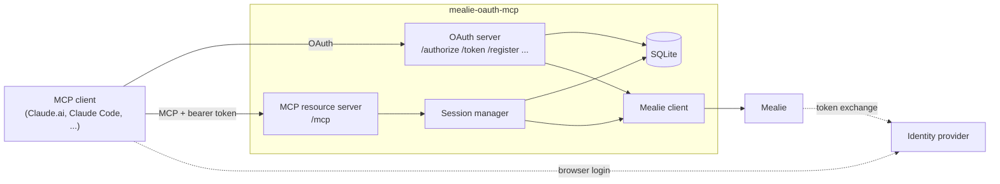
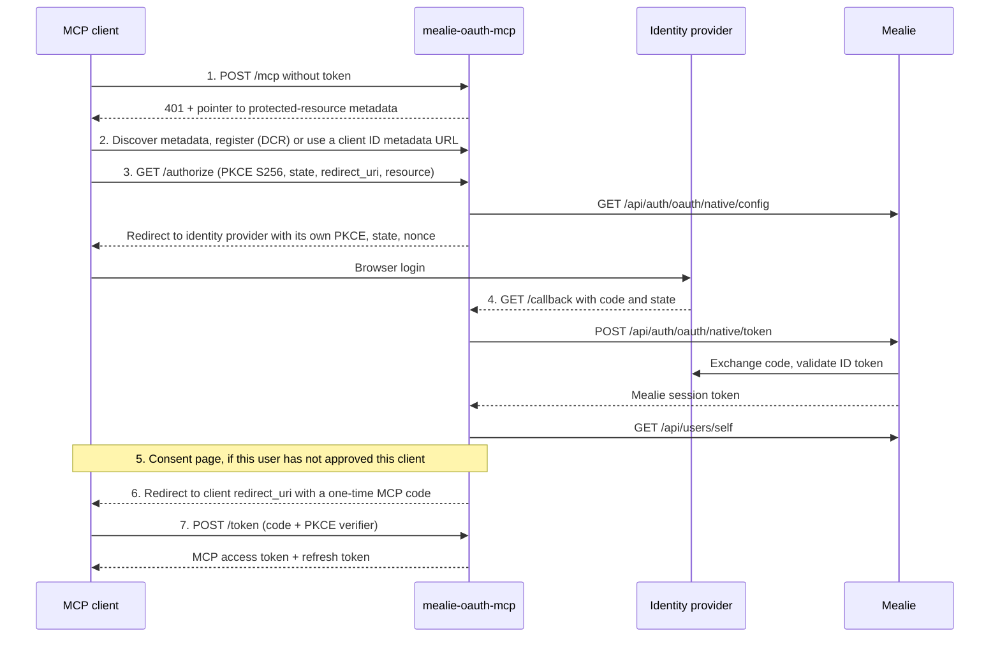

# Architecture

This page explains how mealie-oauth-mcp is built and why. The reasons behind
single decisions live in the [decision records](adr/README.md). For setup and
operation, see the [README](../README.md). For working on the code, see
[CONTRIBUTING.md](../CONTRIBUTING.md).

## Components

One Go binary serves three roles on one origin, `PUBLIC_URL`:

1. **OAuth 2.1 authorization server** for MCP clients. It issues its own
   tokens and delegates the actual user login to the identity provider
   through Mealie's native OIDC flow.
2. **MCP resource server** at `/mcp`, protected by bearer-token middleware.
3. **Mealie client.** It calls Mealie with the logged-in user's Mealie
   session token.

The agent never receives the Mealie token. It only gets MCP tokens, which are
worthless outside this server.

### Packages

`cmd/mealie-oauth-mcp/` holds `main` only: parse config, wire dependencies,
call `run(ctx)`. Everything else is under `internal/`.

| Package | Role |
|---|---|
| `app` | Wiring, routes, startup checks, health endpoints |
| `oauth` | Authorization server: metadata, registration, authorize, callback, consent, token, revoke |
| `session` | Verifies MCP access tokens and renews Mealie tokens on use |
| `mcpserver` | MCP tools |
| `allowlist` | Path and method rules for the `mealie_api` tool |
| `mealie` | Hand-written Mealie API client |
| `store` | SQLite storage, migrations, backup, data-dir lock |
| `token` | Random opaque tokens and their SHA-256 hashes |
| `tokencrypt` | AES-GCM encryption with a rotatable key ring |
| `secret` | Type that keeps secret values out of logs |
| `config` | Environment parsing and validation |
| `audit` | Audit events |
| `obs` | Logging, request IDs, access log |
| `metrics` | Prometheus metrics |
| `tracing` | Optional OTLP tracing |
| `httpx` | HTTP middleware and rate limiting |
| `view` | Compact, null-free output for tool results |
| `codestyle` | The no-comments test |

### Endpoints

| Path | Purpose |
|---|---|
| `/.well-known/oauth-protected-resource` | Protected-resource metadata (RFC 9728) |
| `/.well-known/oauth-authorization-server` | Authorization-server metadata (RFC 8414) |
| `/register` | Dynamic client registration (RFC 7591), public clients only |
| `/authorize` | Start a login |
| `/callback` | Redirect target for the identity provider |
| `/consent` | Consent form submit |
| `/token` | `authorization_code` and `refresh_token` grants |
| `/revoke` | Token revocation (RFC 7009) |
| `/mcp` | MCP Streamable HTTP |
| `/healthz` | Liveness: the process is up |
| `/readyz` | Readiness: the database answers and Mealie is reachable |
| `/metrics` | Prometheus metrics, on the separate `METRICS_ADDR` listener only |

Use `/healthz` for restart decisions and `/readyz` for readiness probes.

## Login flow

Mealie already knows how to log users in through the identity provider. This
server reuses that: it asks Mealie for its OIDC settings, sends the browser to
the identity provider, and hands the returned code to Mealie's native token
endpoint. Mealie checks the ID token and returns a normal Mealie session
token.

1. The client calls `/mcp` without a token. It gets `401` with a
   `WWW-Authenticate` header that points at the protected-resource metadata.
2. The client reads the authorization-server metadata. It identifies itself
   by dynamic client registration or by a client ID metadata document, an
   HTTPS URL the server fetches.
3. The client opens `/authorize` with PKCE (S256 required), `state`,
   `redirect_uri` and `resource`. The server validates them, stores a pending
   authorization, creates its own PKCE verifier, `state` and `nonce` for the
   upstream leg, and redirects the browser to the identity provider with
   `redirect_uri` set to `PUBLIC_URL/callback`.
4. The identity provider redirects to `/callback`. The server checks `state`,
   exchanges the code through Mealie, and calls `GET /api/users/self` to learn
   who logged in.
5. If this Mealie user has not approved this client before, the server shows
   the consent page.
6. The server creates a session, issues a one-time MCP authorization code and
   redirects to the client.
7. The client exchanges the code at `/token`. The server verifies PKCE and
   returns an access token and a refresh token.

Mealie does not check the redirect URI itself, so the identity provider must
allow `PUBLIC_URL/callback` on Mealie's OIDC client. See
[Identity-provider setup](../README.md#identity-provider-setup).

## Session model

A session is one successful login: one Mealie user and one MCP client.

- **MCP tokens are opaque.** Access and refresh tokens are random values.
  Only their SHA-256 hashes are stored. The access token lives for
  `ACCESS_TOKEN_TTL` (default 1 hour).
- **Refresh tokens rotate on every use.** If a rotated token is presented
  again, the server treats it as stolen and revokes the whole session. The
  same applies to a reused authorization code.
- **Mealie tokens are encrypted at rest** with AES-GCM and renewed on use.
  When a request arrives and the stored Mealie token is past half its
  lifetime, the server calls Mealie's `/api/auth/refresh` first.
- **The idle limit follows Mealie's `TOKEN_TIME`** (48 hours by default). It
  is not a setting here. A session unused for longer than the Mealie token
  lifetime cannot be renewed, and the next call gets `401`, which makes the
  client log in again. A Mealie outage keeps sessions; only a `401` from
  Mealie ends one.
- **`SESSION_MAX_AGE` is the absolute cap** (default 720 hours). Mealie
  never asks the identity provider again after login, so this cap is the only
  way a deactivated identity-provider account eventually loses access.
- **Revocation** happens when the client calls `/revoke`, when a refresh
  token is reused, when Mealie answers `401`, or when a session passes its
  cap. The next call then needs a new login.

Expired rows are deleted by a periodic cleanup job. See
[Sessions](../README.md#sessions) for the operator view.

## Security model

These rules come from the project's anti-goals. A change that breaks one is
wrong even if the tests pass. Each rule has tests, including bypass attempts.

- **No token leakage.** Tokens, authorization codes, PKCE verifiers and
  `Authorization` headers are never logged or returned, including in error
  messages and tool output. The `secret` type enforces this in code. Mealie
  error bodies go through redaction before an agent sees them.
- **`PUBLIC_URL` comes from config only**, never from request headers.
  Redirects, metadata and cookie flags are built from it.
- **No admin reachability.** No tool and no `mealie_api` path reaches Mealie
  admin, auth, API-token, user-management, webhook or notification endpoints.
  Admins can log in; the tool surface just has no way to their features.
- **`mealie_api` is a fail-closed allowlist.** Paths are normalised before
  matching: only `/api/` paths are allowed, and anything that is not a plain
  path (query or fragment, backslash, double encoding, empty or dot segments)
  is denied. Endpoints that Mealie adds later stay
  blocked until someone adds them on purpose.
- **Encryption with key rotation.** `ENCRYPTION_KEYS` is a list; the first key
  encrypts and all keys decrypt. See
  [Encryption key rotation](../README.md#encryption-key-rotation).
- **Consent once per user and client** blocks the confused-deputy attack that
  open client registration would otherwise allow.

**Audit log.** Login, consent, client registration, token and session events
are written as JSON log lines with `log_type` set to `audit`. They carry IDs
and outcomes, never secrets.

**Observability without secrets.** Logs, metrics labels and trace spans use
route patterns and tool names. Spans never record URLs, queries, headers,
tokens or client addresses.

## Storage and operations

- **One instance, one SQLite file** in `DATA_DIR`, opened in WAL mode. A lock
  file in the data directory stops a second process from using the same
  database. There is no clustering.
- **Migrations** are embedded in the binary and run with goose at startup.
  The server refuses to start on a schema newer than it knows.
- **Backups** use the `backup` subcommand, which copies the database
  consistently while the server runs. See [Backups](../README.md#backups) and
  [Restore](../README.md#restore).
- **Metrics** are served on a separate listener, `METRICS_ADDR`, and **tracing**
  is on when `OTEL_EXPORTER_OTLP_ENDPOINT` is set. See
  [Monitoring](../README.md#monitoring).
- **Releases** are described in [Releases](../README.md#releases), including
  how to verify images and binaries.

## Where to go next

- [Decision records](adr/README.md) for the reasons behind these choices.
- [Adding a tool](../CONTRIBUTING.md#adding-a-tool) and the
  [tool stability policy](../CONTRIBUTING.md#tool-stability-policy).
- [Development environment](../CONTRIBUTING.md#development-environment) and
  [tests](../CONTRIBUTING.md#tests).
